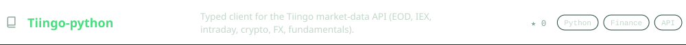
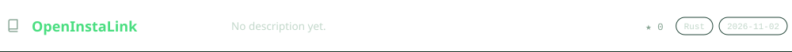
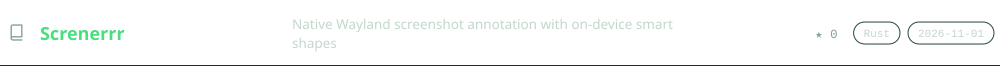
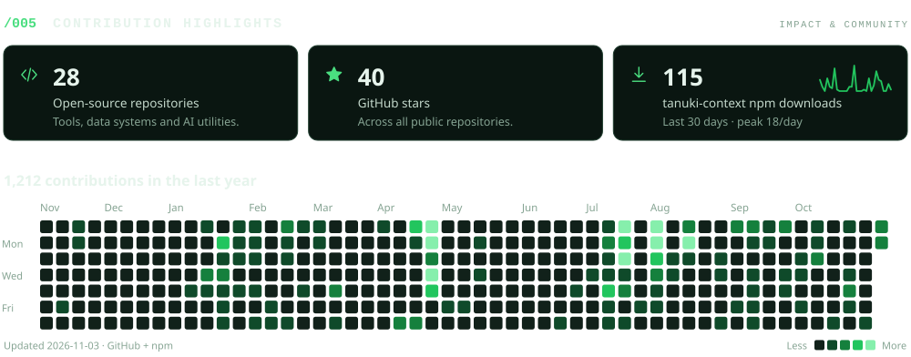

<picture>
  <source media="(max-width: 600px)" srcset="./assets/header-mobile.svg">
  
</picture>

<p align="center">
  <a href="https://osyna.com">Website</a> &nbsp; · &nbsp;
  <a href="mailto:contact@osyna.com">Work with me</a> &nbsp; · &nbsp;
  <a href="https://www.linkedin.com/in/irvinheslan">LinkedIn</a> &nbsp; · &nbsp;
  Brussels, Belgium
</p>

<p>
<picture>
  <source media="(max-width: 600px) and (prefers-color-scheme: light)" srcset="./assets/title-featured-mobile-light.svg">
  <source media="(max-width: 600px)" srcset="./assets/title-featured-mobile-dark.svg">
  <source media="(prefers-color-scheme: light)" srcset="./assets/title-featured-light.svg">
  
</picture>
<a href="https://github.com/Osyna/tanuki-context"><picture>
  <source media="(max-width: 600px) and (prefers-color-scheme: light)" srcset="./assets/repo-tanuki-context-mobile-light.svg">
  <source media="(max-width: 600px)" srcset="./assets/repo-tanuki-context-mobile-dark.svg">
  <source media="(prefers-color-scheme: light)" srcset="./assets/repo-tanuki-context-light.svg">
  
</picture></a>
<a href="https://github.com/Osyna/Macaw"><picture>
  <source media="(max-width: 600px) and (prefers-color-scheme: light)" srcset="./assets/repo-macaw-mobile-light.svg">
  <source media="(max-width: 600px)" srcset="./assets/repo-macaw-mobile-dark.svg">
  <source media="(prefers-color-scheme: light)" srcset="./assets/repo-macaw-light.svg">
  
</picture></a>
<a href="https://github.com/Osyna/QuestionAir"><picture>
  <source media="(max-width: 600px) and (prefers-color-scheme: light)" srcset="./assets/repo-questionair-mobile-light.svg">
  <source media="(max-width: 600px)" srcset="./assets/repo-questionair-mobile-dark.svg">
  <source media="(prefers-color-scheme: light)" srcset="./assets/repo-questionair-light.svg">
  
</picture></a>
<a href="https://github.com/Osyna/Tiingo-python"><picture>
  <source media="(max-width: 600px) and (prefers-color-scheme: light)" srcset="./assets/repo-tiingo-python-mobile-light.svg">
  <source media="(max-width: 600px)" srcset="./assets/repo-tiingo-python-mobile-dark.svg">
  <source media="(prefers-color-scheme: light)" srcset="./assets/repo-tiingo-python-light.svg">
  
</picture></a>
<a href="https://github.com/Osyna/RadiAll"><picture>
  <source media="(max-width: 600px) and (prefers-color-scheme: light)" srcset="./assets/repo-radiall-mobile-light.svg">
  <source media="(max-width: 600px)" srcset="./assets/repo-radiall-mobile-dark.svg">
  <source media="(prefers-color-scheme: light)" srcset="./assets/repo-radiall-light.svg">
  
</picture></a>
<a href="https://github.com/Osyna/Pinna"><picture>
  <source media="(max-width: 600px) and (prefers-color-scheme: light)" srcset="./assets/repo-pinna-mobile-light.svg">
  <source media="(max-width: 600px)" srcset="./assets/repo-pinna-mobile-dark.svg">
  <source media="(prefers-color-scheme: light)" srcset="./assets/repo-pinna-light.svg">
  
</picture></a>
</p>

<!-- latest-projects:start -->
<p>
<picture>
  <source media="(max-width: 600px) and (prefers-color-scheme: light)" srcset="./assets/title-latest-mobile-light.svg">
  <source media="(max-width: 600px)" srcset="./assets/title-latest-mobile-dark.svg">
  <source media="(prefers-color-scheme: light)" srcset="./assets/title-latest-light.svg">
  
</picture>
<a href="https://github.com/Osyna/OpenInstaLink"><picture>
  <source media="(max-width: 600px) and (prefers-color-scheme: light)" srcset="./assets/recent-1-mobile-light.svg">
  <source media="(max-width: 600px)" srcset="./assets/recent-1-mobile-dark.svg">
  <source media="(prefers-color-scheme: light)" srcset="./assets/recent-1-light.svg">
  
</picture></a>
<a href="https://github.com/Osyna/Overglass"><picture>
  <source media="(max-width: 600px) and (prefers-color-scheme: light)" srcset="./assets/recent-2-mobile-light.svg">
  <source media="(max-width: 600px)" srcset="./assets/recent-2-mobile-dark.svg">
  <source media="(prefers-color-scheme: light)" srcset="./assets/recent-2-light.svg">
  
</picture></a>
<a href="https://github.com/Osyna/CPMAC-Plugins"><picture>
  <source media="(max-width: 600px) and (prefers-color-scheme: light)" srcset="./assets/recent-3-mobile-light.svg">
  <source media="(max-width: 600px)" srcset="./assets/recent-3-mobile-dark.svg">
  <source media="(prefers-color-scheme: light)" srcset="./assets/recent-3-light.svg">
  
</picture></a>
<a href="https://github.com/Osyna/Screnerrr"><picture>
  <source media="(max-width: 600px) and (prefers-color-scheme: light)" srcset="./assets/recent-4-mobile-light.svg">
  <source media="(max-width: 600px)" srcset="./assets/recent-4-mobile-dark.svg">
  <source media="(prefers-color-scheme: light)" srcset="./assets/recent-4-light.svg">
  
</picture></a>
</p>
<!-- latest-projects:end -->

<picture>
  <source media="(max-width: 600px) and (prefers-color-scheme: light)" srcset="./assets/expertise-mobile-light.svg">
  <source media="(max-width: 600px)" srcset="./assets/expertise-mobile-dark.svg">
  <source media="(prefers-color-scheme: light)" srcset="./assets/expertise-light.svg">
  
</picture>

<picture>
  <source media="(max-width: 600px) and (prefers-color-scheme: light)" srcset="./assets/highlights-mobile-light.svg">
  <source media="(max-width: 600px)" srcset="./assets/highlights-mobile-dark.svg">
  <source media="(prefers-color-scheme: light)" srcset="./assets/highlights-light.svg">
  
</picture>

[All repositories](https://github.com/Osyna?tab=repositories) · [tanuki-context on npm](https://www.npmjs.com/package/tanuki-context) · [Macaw website](https://macaw.osyna.com)

<details>
<summary>Project notes & more open source</summary>

- [tanuki-context](https://github.com/Osyna/tanuki-context): renders logs and command output as dense image pages or stores them for retrieval by slice. Its published evaluation reports 79–91% token savings on compressible inputs. It prices each strategy against the target model and keeps plain text when that is cheaper. Zero runtime dependencies.
- [Macaw](https://github.com/Osyna/Macaw): hot-swappable speech-to-text engines, including Whisper, Moonshine and Parakeet. CUDA decode with ROCm/CPU fallback; backends run in separate environments.
- [QuestionAir](https://github.com/Osyna/QuestionAir): LLaMA via Ollama, embedding-based keyword extraction, French checks through spaCy. FastAPI, Pydantic and SQLite behind Next.js.
- [Tiingo-python](https://github.com/Osyna/Tiingo-python): EOD, IEX intraday, crypto, FX and fundamentals, with full annotations and httpx.
- [RadiAll](https://github.com/Osyna/RadiAll): a Rust radial application launcher for Wayland.
- [Pinna](https://github.com/Osyna/Pinna): a self-hostable alternative to Mapstr, built with Vue.

Also [QML](https://github.com/Osyna/QML), [AzureBlobStorageExplorer](https://github.com/Osyna/AzureBlobStorageExplorer), [GrafanaPrometheus_4_Coolify](https://github.com/Osyna/GrafanaPrometheus_4_Coolify), [YTM-Player](https://github.com/Osyna/YTM-Player) and [Dot.Files](https://github.com/Osyna/Dot.Files).

</details>

<details>
<summary>How this profile stays up to date</summary>

The [nightly workflow](./.github/workflows/pulse.yml) refreshes the latest original projects (newest by creation date, excluding forks and archived repositories), counters, repository stars, the contribution calendar and npm downloads.

Every panel is a plain SVG built by [the renderer](./scripts/render.mjs) on Node.js 22, with no dependencies. The header's pixel-matrix wave is a CSS animation inside the SVG: each row of pixels shares one brightness curve sampled over a full period, and each column starts it at a different point, so the waves travel and loop without a jump. Browsers that request reduced motion get a still frame. Each panel has dark and light variants, plus a narrow layout for phones.

To check and refresh locally:

```sh
npm test
npm run render
```

An optional `GH_TOKEN` raises the GitHub API rate limit; it is sent only to `api.github.com`. Data validation, README marker checks and rendering complete in memory before any file is written, so failed requests or malformed data leave the published panels intact. If GitHub changes its public calendar markup, the parser may need an update.

</details>
