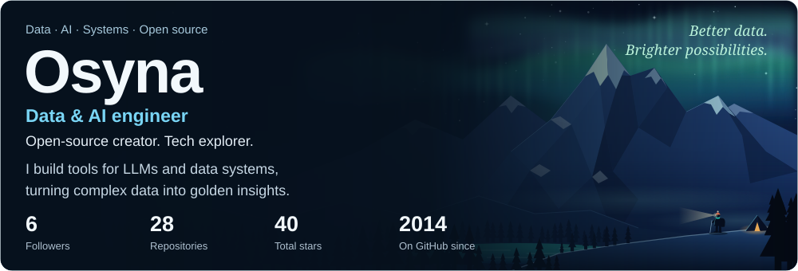
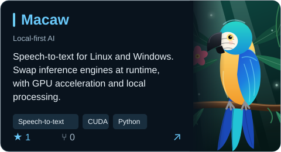
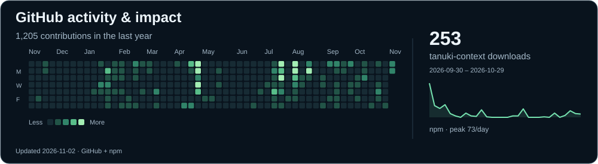
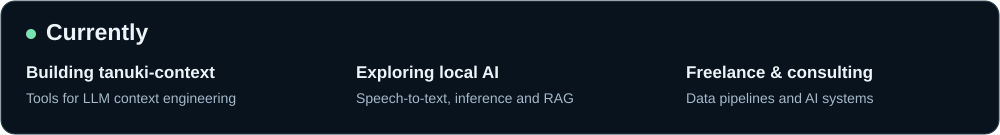
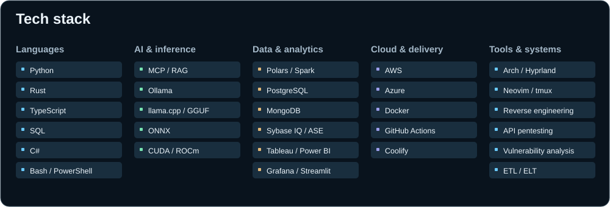

<picture>
  <source media="(max-width: 600px) and (prefers-color-scheme: light)" srcset="./assets/hero-mobile-light.svg">
  <source media="(max-width: 600px)" srcset="./assets/hero-mobile-dark.svg">
  <source media="(prefers-color-scheme: light)" srcset="./assets/hero-light.svg">
  
</picture>

<p align="center">
  <a href="https://osyna.com">Website</a> &nbsp; · &nbsp;
  <a href="mailto:contact@osyna.com">Work with me</a> &nbsp; · &nbsp;
  <a href="https://www.linkedin.com/in/irvinheslan">LinkedIn</a> &nbsp; · &nbsp;
  Brussels, Belgium
</p>

## Featured projects

<table>
<tr>
<td width="50%" valign="top">
<a href="https://github.com/Osyna/tanuki-context">
<picture>
  <source media="(max-width: 600px) and (prefers-color-scheme: light)" srcset="./assets/tanuki-mobile-light.svg">
  <source media="(max-width: 600px)" srcset="./assets/tanuki-mobile-dark.svg">
  <source media="(prefers-color-scheme: light)" srcset="./assets/tanuki-light.svg">
  
</picture>
</a>
</td>
<td width="50%" valign="top">
<a href="https://github.com/Osyna/Macaw">
<picture>
  <source media="(max-width: 600px) and (prefers-color-scheme: light)" srcset="./assets/macaw-mobile-light.svg">
  <source media="(max-width: 600px)" srcset="./assets/macaw-mobile-dark.svg">
  <source media="(prefers-color-scheme: light)" srcset="./assets/macaw-light.svg">
  
</picture>
</a>
</td>
</tr>
<tr>
<td width="50%" valign="top">
<a href="https://github.com/Osyna/QuestionAir">
<picture>
  <source media="(max-width: 600px) and (prefers-color-scheme: light)" srcset="./assets/question-mobile-light.svg">
  <source media="(max-width: 600px)" srcset="./assets/question-mobile-dark.svg">
  <source media="(prefers-color-scheme: light)" srcset="./assets/question-light.svg">
  
</picture>
</a>
</td>
<td width="50%" valign="top">
<a href="https://github.com/Osyna/Tiingo-python">
<picture>
  <source media="(max-width: 600px) and (prefers-color-scheme: light)" srcset="./assets/market-mobile-light.svg">
  <source media="(max-width: 600px)" srcset="./assets/market-mobile-dark.svg">
  <source media="(prefers-color-scheme: light)" srcset="./assets/market-light.svg">
  
</picture>
</a>
</td>
</tr>
<tr>
<td width="50%" valign="top">
<a href="https://github.com/Osyna/RadiAll">
<picture>
  <source media="(max-width: 600px) and (prefers-color-scheme: light)" srcset="./assets/radial-mobile-light.svg">
  <source media="(max-width: 600px)" srcset="./assets/radial-mobile-dark.svg">
  <source media="(prefers-color-scheme: light)" srcset="./assets/radial-light.svg">
  
</picture>
</a>
</td>
<td width="50%" valign="top">
<a href="https://github.com/Osyna/Pinna">
<picture>
  <source media="(max-width: 600px) and (prefers-color-scheme: light)" srcset="./assets/map-mobile-light.svg">
  <source media="(max-width: 600px)" srcset="./assets/map-mobile-dark.svg">
  <source media="(prefers-color-scheme: light)" srcset="./assets/map-light.svg">
  
</picture>
</a>
</td>
</tr>
</table>

[All repositories](https://github.com/Osyna?tab=repositories) · [tanuki-context on npm](https://www.npmjs.com/package/tanuki-context) · [Macaw website](https://macaw.osyna.com)

<picture>
  <source media="(max-width: 600px) and (prefers-color-scheme: light)" srcset="./assets/activity-mobile-light.svg">
  <source media="(max-width: 600px)" srcset="./assets/activity-mobile-dark.svg">
  <source media="(prefers-color-scheme: light)" srcset="./assets/activity-light.svg">
  
</picture>

<picture>
  <source media="(max-width: 600px) and (prefers-color-scheme: light)" srcset="./assets/currently-mobile-light.svg">
  <source media="(max-width: 600px)" srcset="./assets/currently-mobile-dark.svg">
  <source media="(prefers-color-scheme: light)" srcset="./assets/currently-light.svg">
  
</picture>

<picture>
  <source media="(max-width: 600px) and (prefers-color-scheme: light)" srcset="./assets/stack-mobile-light.svg">
  <source media="(max-width: 600px)" srcset="./assets/stack-mobile-dark.svg">
  <source media="(prefers-color-scheme: light)" srcset="./assets/stack-light.svg">
  
</picture>

<details>
<summary>Project notes & more open source</summary>

- [tanuki-context](https://github.com/Osyna/tanuki-context): renders logs and command output as dense image pages or stores them for retrieval by slice. Its published evaluation reports 79–91% token savings on compressible inputs. It prices each strategy against the target model and keeps plain text when that is cheaper. Zero runtime dependencies.
- [Macaw](https://github.com/Osyna/Macaw): hot-swappable speech-to-text engines, including Whisper, Moonshine and Parakeet. CUDA decode with ROCm/CPU fallback; backends run in separate environments.
- [QuestionAir](https://github.com/Osyna/QuestionAir): LLaMA via Ollama, embedding-based keyword extraction, French checks through spaCy. FastAPI, Pydantic and SQLite behind Next.js.
- [Tiingo-python](https://github.com/Osyna/Tiingo-python): EOD, IEX intraday, crypto, FX and fundamentals, with full annotations and httpx.
- [RadiAll](https://github.com/Osyna/RadiAll): a Rust radial application launcher for Wayland.
- [Pinna](https://github.com/Osyna/Pinna): a self-hostable alternative to Mapstr, built with Vue.

Also [QML](https://github.com/Osyna/QML), [AzureBlobStorageExplorer](https://github.com/Osyna/AzureBlobStorageExplorer), [GrafanaPrometheus_4_Coolify](https://github.com/Osyna/GrafanaPrometheus_4_Coolify), [YTM-Player](https://github.com/Osyna/YTM-Player) and [Dot.Files](https://github.com/Osyna/Dot.Files).

</details>

<details>
<summary>How this profile stays up to date</summary>

The [nightly workflow](./.github/workflows/pulse.yml) refreshes the counters, repository stars and forks, contribution calendar, and npm download chart. The calendar comes from GitHub's public contribution page; downloads come from npm's reported interval, which may lag today. Counts are snapshots, not real-time widgets.

All artwork is drawn in [SVG](./scripts/art.mjs). [The renderer](./scripts/render.mjs) produces self-contained dark, light, and mobile layouts using Node.js 22 and no runtime dependencies. The aurora respects reduced-motion preferences. Every panel remains visible without animation.

To check and refresh locally:

```sh
npm test
npm run render
```

An optional `GH_TOKEN` raises the GitHub API rate limit; it is sent only to `api.github.com`. Failed requests or malformed data stop the refresh before assets are written, leaving the published panels intact. If GitHub changes its public calendar markup, the parser may need an update.

</details>
